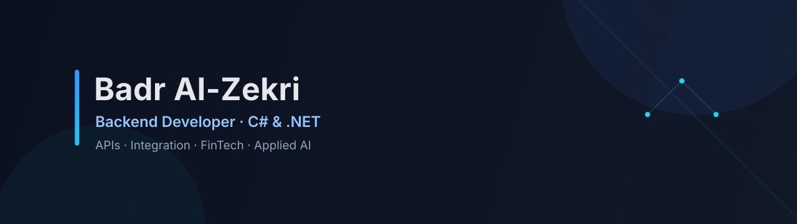

  

  
  
  

<h1 align="center">Hi, I'm Badr Al-Zekri 👋</h1>

  <strong>Software Developer · Product Builder · Continuous Learner</strong>

  I build practical digital products with an emphasis on clean interfaces,
  maintainable architecture, and thoughtful user experiences.

  <a href="#featured-projects">Featured Projects</a> ·
  <a href="#technology-stack">Technology Stack</a> ·
  <a href="#current-focus">Current Focus</a> ·
  <a href="#connect">Connect</a>

## About me

- 🧩 Building web products from interface to backend
- 🏗️ Exploring modular architecture, clean code, and reliable delivery
- 🌍 Interested in Arabic-first and accessible user experiences
- 📱 Developing mobile applications with Flutter and Dart
- 🤖 Exploring AI-assisted development workflows responsibly
- 📚 Learning in public through hands-on projects and documentation

## Technology stack

  

| Area | Tools and practices |
| --- | --- |
| Frontend | React, TypeScript, Tailwind CSS, Vite, responsive UI |
| Backend and web | Laravel, PHP, Blade, Bootstrap, REST-oriented development |
| Mobile | Flutter, Dart, cross-platform application foundations |
| Engineering | Git, GitHub, readable code, incremental delivery, documentation |

## Featured projects

<table>
  <tr>
    <td width="33%" valign="top">
      <h3><a href="https://github.com/Badr-Al-Zekri/khuta">Khuta</a></h3>
      
Arabic-first habit-tracking product with a local-first experience and a focused, practical interface.

      
<code>React</code> <code>TypeScript</code> <code>Tailwind CSS</code>

    </td>
    <td width="33%" valign="top">
      <h3><a href="https://github.com/Badr-Al-Zekri/DevPhoria">DevPhoria</a></h3>
      
Responsive IT solutions website structured as a multi-page Laravel application.

      
<code>Laravel</code> <code>PHP</code> <code>Blade</code> <code>Bootstrap</code>

    </td>
    <td width="33%" valign="top">
      <h3><a href="https://github.com/Badr-Al-Zekri/TailorHouse">TailorHouse</a></h3>
      
Flutter application foundation for exploring cross-platform mobile product development.

      
<code>Flutter</code> <code>Dart</code>

    </td>
  </tr>
</table>

  

## Current focus

- Delivering complete product slices instead of isolated demos
- Improving backend design, API integration, and application reliability
- Creating polished, accessible, and responsive interfaces
- Turning project experiments into maintainable portfolio products

  
<strong>My engineering principles</strong>

   

  - Prefer clarity over cleverness.
  - Keep responsibilities small and boundaries explicit.
  - Validate behavior with tests and real user flows.
  - Document important decisions so projects remain understandable.
  - Improve incrementally and ship working software.

## GitHub activity

  
  

  

## Connect

  
  

  <i>Always learning, building, and improving one thoughtful commit at a time.</i>

