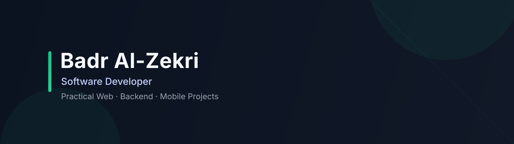

  

## Badr Al-Zekri

Software developer focused on building practical products and steadily improving engineering depth through real project work.

### Focus

- Web interfaces and product-oriented frontend development
- Backend-powered web applications
- Mobile app foundations with Flutter
- Ongoing exploration of AI-assisted development workflows

### Selected Projects

- **[Khuta](https://github.com/Badr-Al-Zekri/khuta)**  
  Behavioral habit-tracking web app built with React, TypeScript, and Tailwind CSS, with local-first data handling and Arabic-first UX.

- **[DevPhoria](https://github.com/Badr-Al-Zekri/DevPhoria)**  
  Laravel-based IT solutions landing site adapted from an HTML Codex template and structured into multiple responsive pages.

- **[TailorHouse](https://github.com/Badr-Al-Zekri/TailorHouse)**  
  Flutter project scaffold used as a base for mobile application development experiments.

### Working Style

I prefer clean architecture, readable implementation, and incremental delivery. I document decisions clearly and keep projects maintainable as they evolve.
